# MEEDX · Local Cinema (`v1.0.0-beta.11`)

<p align="center">
  <a href="https://meedx.pages.dev">
    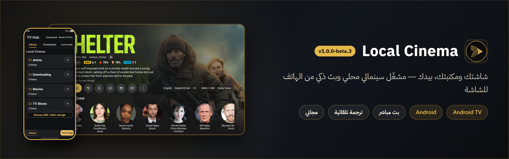
  </a>
</p>

منظومة **Local Cinema** المتكاملة تجمع مكتبة أفلامك ومسلسلاتك المحلية وعبر الويب على شاشة **Android TV** بواجهة سينمائية ذكية تجلب البوسترات والتقييمات والترجمة العربية تلقائياً، وتحوّل هاتفك إلى ريموت وماوس هوائي ويد تحكم متكاملة. الإصدار الأول من **MEEDX** — استوديو تطوير التطبيقات والألعاب والحلول التقنية.

The complete **Local Cinema** suite brings your local and web movies and series to **Android TV** with a smart cinematic interface featuring automatic posters, ratings, and Arabic subtitles—while turning your phone into a full remote, air mouse, and gamepad. The debut release by **MEEDX** — a studio for apps, games, and tech solutions.

<p align="center">
  <a href="https://meedx.pages.dev"><strong>🌐 زيارة الموقع الرسمي الحي | Visit Live Website (meedx.pages.dev)</strong></a>
  &nbsp;·&nbsp;
  <a href="https://github.com/alnouri96/meedx/releases/tag/v1.0.0-beta.11"><strong>⬇️ تحميل v1.0.0-beta.11 | Releases</strong></a>
  &nbsp;·&nbsp;
  <a href="https://meedx.pages.dev/#support"><strong>💛 صفحة الدعم | Support Page</strong></a>
  &nbsp;·&nbsp;
  <a href="https://t.me/MEEDXAPP"><strong>💬 تلجرام | Telegram (@MEEDXAPP)</strong></a>
</p>

---

## دعم المشروع | Support the Project

> يمكنك دعم تطوير **MEEDX · Local Cinema** مباشرة عبر مسح أحد رموز الـ QR التالية أو استخدام صفحة الدعم التفاعلية على الموقع: **[https://meedx.pages.dev/#support](https://meedx.pages.dev/#support)**

| **زين كاش · ZainCash** | **كي كارد / الماستر · QiCard** |
| :---: | :---: |
|  |  |
| **`+964781714448`** | **`7110031577`** |

- **الموقع الرسمي / Live Website:** [https://meedx.pages.dev](https://meedx.pages.dev)
- **التواصل والطلبات / Telegram:** [https://t.me/MEEDXAPP](https://t.me/MEEDXAPP)
- **صفحة الدعم التفاعلية / Support:** [https://meedx.pages.dev/#support](https://meedx.pages.dev/#support)

---

## لقطات الشاشة | Screenshots

> جميع لقطات الشاشة المعروضة هنا نسخ منظّفة من جلسات البث الفعلية (مع إخفاء رمز الاقتران وعنوان الشبكة المحلية وصور المعرض الجانبية لحماية الخصوصية).
>
> All screenshots below are privacy-redacted captures from synchronized TV and phone sessions.

| المعاينة | التلفاز (`Android TV`) | الهاتف / الحاسوب |
| --- | :---: | :---: |
| **صفحة تفاصيل الفيلم والتقييمات**<br>Movie details and ratings page | 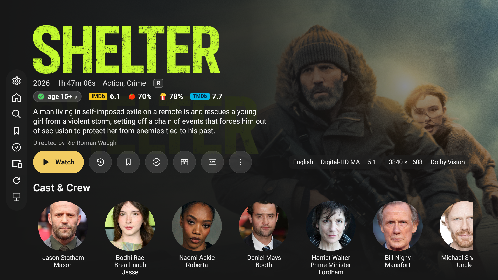 | 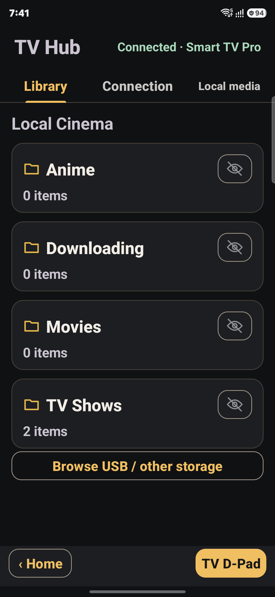 |
| **اقتران الهاتف بالتلفاز**<br>Pairing the phone and TV | 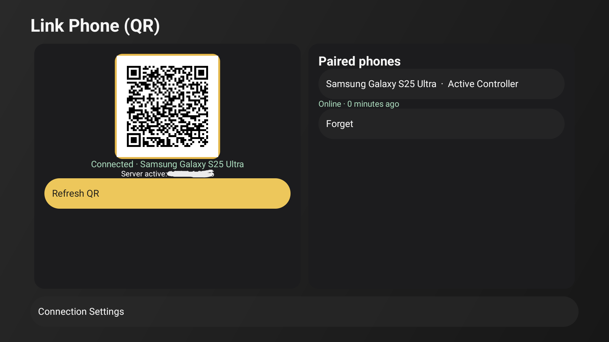 | 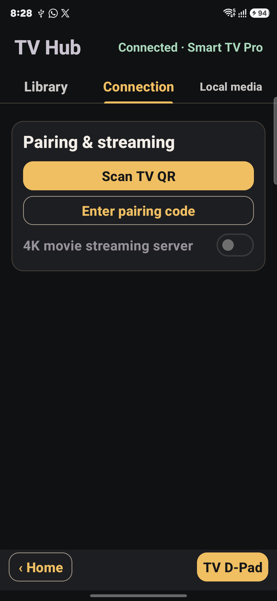 |
| **نشر مكتبة الهاتف على التلفاز**<br>Publishing the phone library to TV |  |  |
| **تشغيل الفيلم والتحكم من الهاتف**<br>Movie playback with phone controls |  | 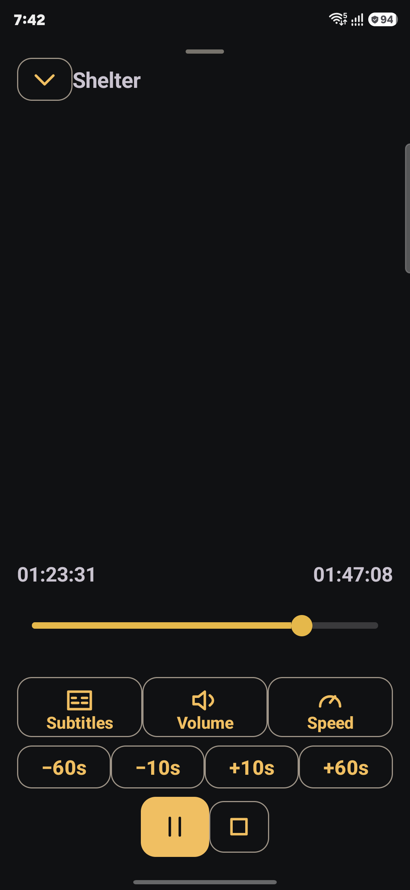 |
| **بث الصوت والموجات الذهبية**<br>Audio casting & gold visualizer |  | 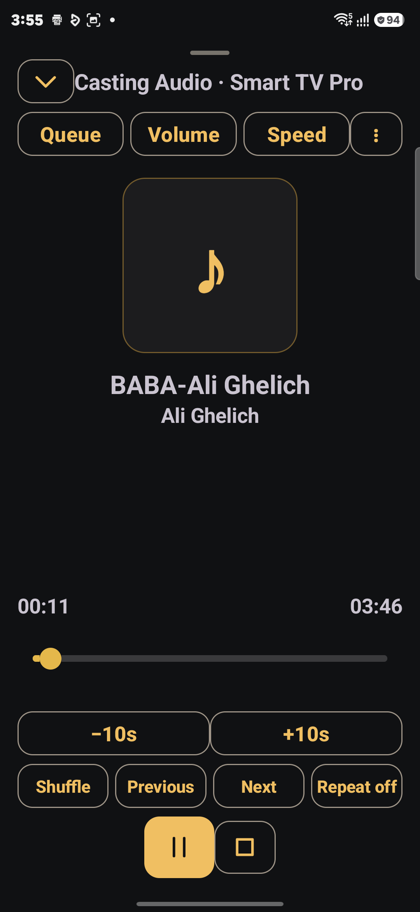 |
| **عرض الصور من الهاتف**<br>Casting photos from the phone |  | 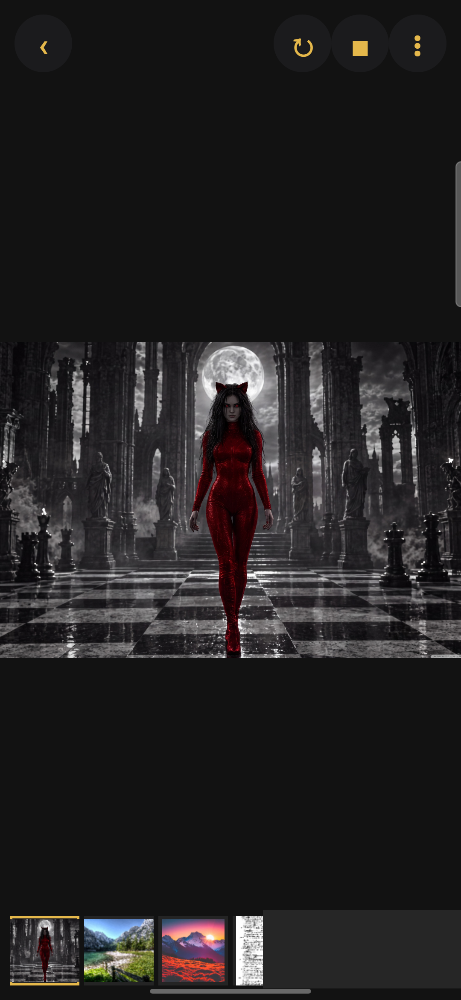 |
| **البحث والكتابة الفورية من الهاتف**<br>Instant search and typing from the phone | 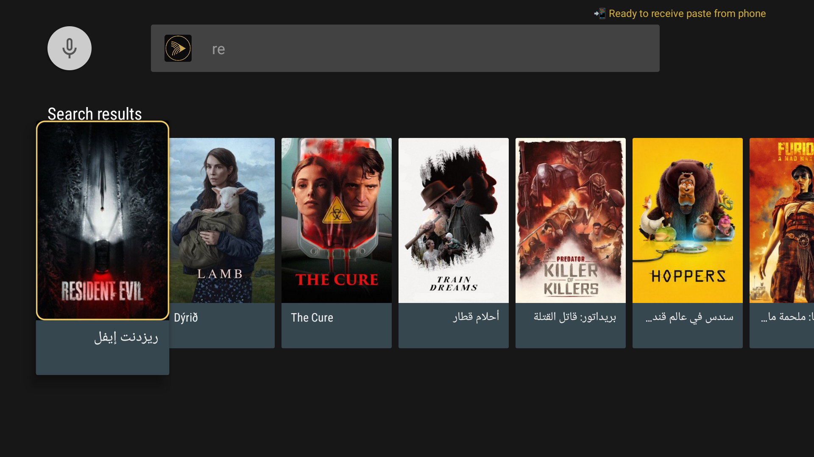 | 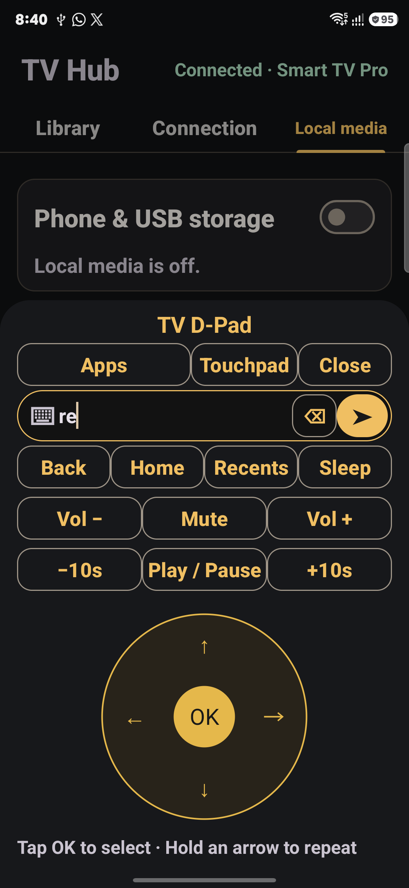 |
| **تفعيل الريموت العام ولوحة اللمس (Touchpad)**<br>System-wide TV Remote & Touchpad | 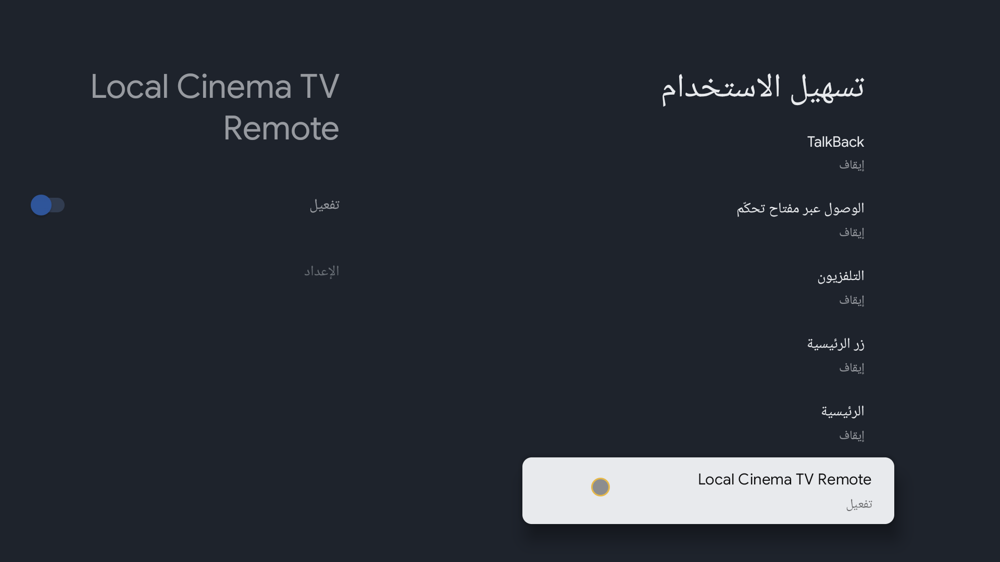 | 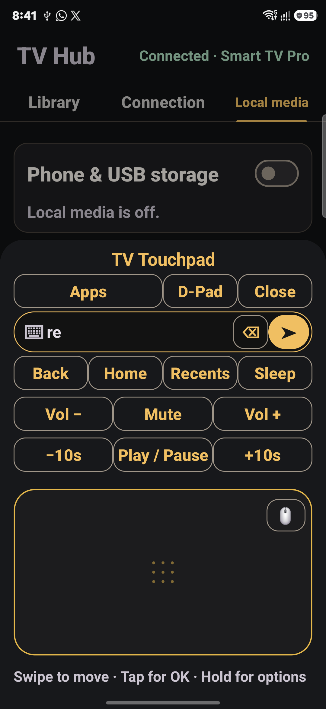 |
| **فتح تطبيقات التلفاز والكتابة داخل المتصفح**<br>TV app launcher and browser typing | 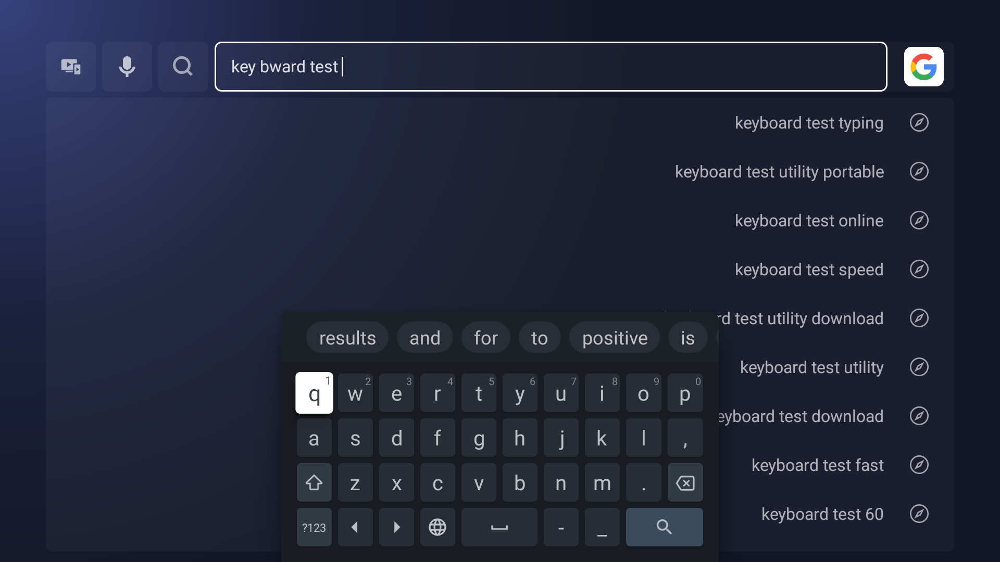 | 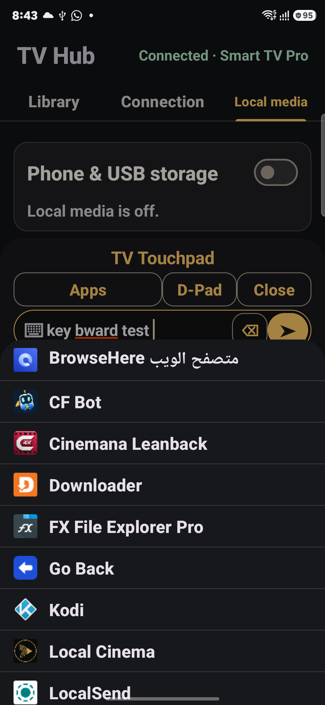 |
| **البحث بالكتابة من الهاتف داخل يوتيوب التلفاز**<br>Typing from the phone inside YouTube on TV | 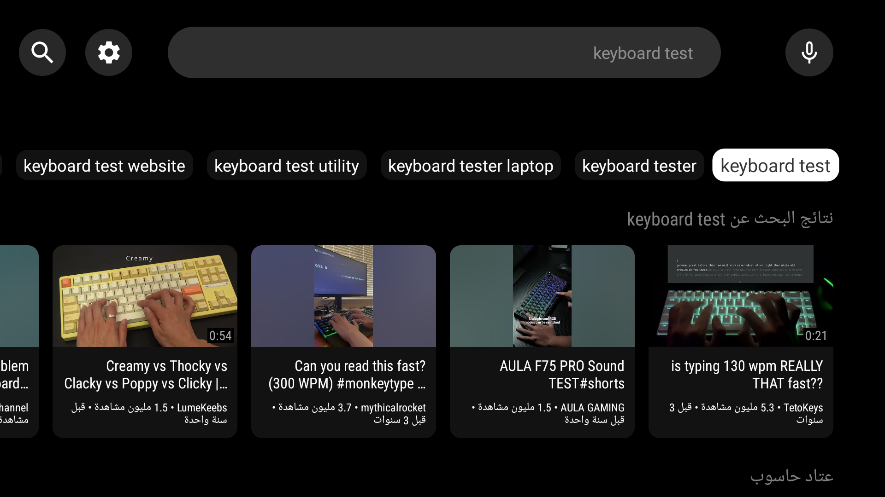 | 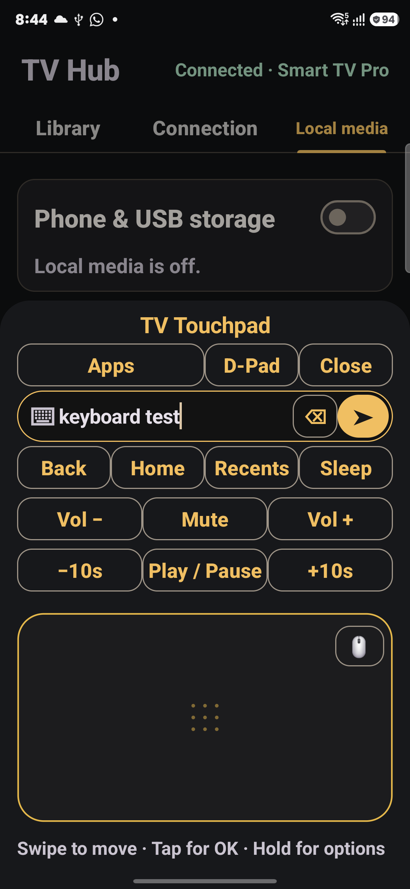 |
| **مشاركة مجلدات الحاسوب عبر الشبكة (SMB)**<br>Sharing Windows PC folders over SMB | 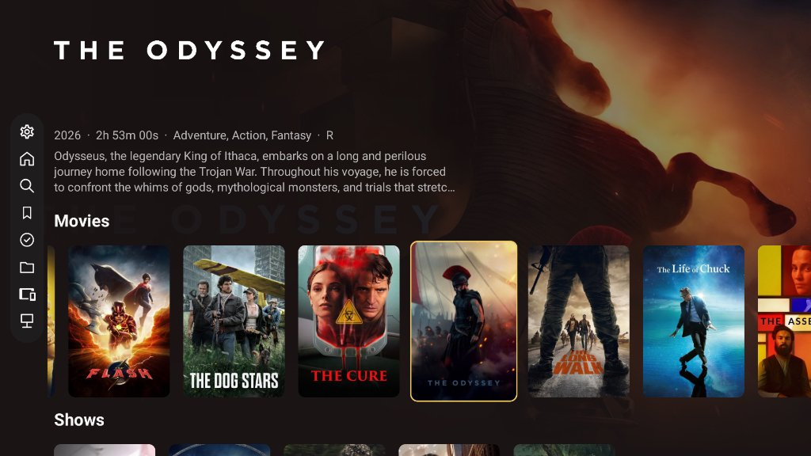 | 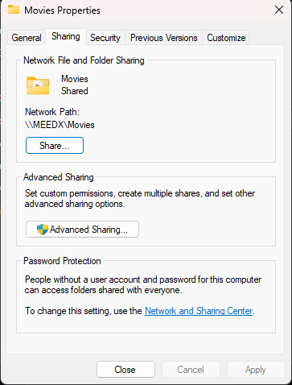 |

---

## العربية — مميزات المنظومة والإرشادات

### جديد الإصدار `v1.0.0-beta.11` (`versionCode = 11`)
- **إعادة هيكلة معمارية تطبيق الهاتف إلى وحدات تحكم مستقلة (`TvHubActivity` و `CinemaBrowser`)**: فصل وحدات الموسيقى (`TvHubMusicController`) والترجمة (`TvHubSubtitlesController`) والمكتبة (`TvHubLibraryController`) والاتصال (`TvHubConnectionController`) وإعدادات المتصفح (`CinemaBrowserSettingsSheet` و `CinemaBrowserMediaBridge`).
- **ضبط أبعاد العرض الطبيعية `100%` للمتصفح مع شريط تكبير دائم (`50%–150%`)**: فتح المتصفح بأبعاد الهاتف الطبيعية `100%` عند بدء التشغيل مع تبديل فوري ونظيف بين وضعي الهاتف وسطح المكتب، وشريط تكبير دائم (`Page Zoom`) ومدير الإضافات الموحّد (`BrowserExtensions`).
- **حماية التخزين التلقائية، قسم `Storage & Cache` بضغطة واحدة، وتوفير البطارية في الخلفية**: تحديد سقف كاش `GeckoView` عند `100 MB`، تنظيف تلقائي لملفات البث المؤقتة عند بدء التشغيل وعند انتهاء البث، إضافة قسم `Storage & Cache` مع زر `Clear Cache` آمن في الإعدادات، وإيقاف نشاط الجلسات والخوادم المحلية عند الخمول.
- **تمييز بصري واضح باللونين الذهبي والأحمر القرمزي لأزرار حالة الترجمة واستقرار التلفاز**: إضاءة عالية التباين لأزرار الترجمة الأساسية (`Primary`) والمزدوجة (`Dual`) والإيقاف (`Off`)، واعتماد معرّفات موجبة (`900M+`) للعناصر السحابية على التلفاز مع مزامنة `Trakt OAuth 2.0 PKCE` عند التغيير أو الطلب اليدوي فقط.

### المميزات الأساسية
- **تشغيل ومكتبة متكاملة على Android TV**: دعم التخزين المحلي وUSB/SAF ومجلدات الشبكة (SMB) والمجلدات المنشورة من الهاتف عبر WebDAV.
- **تطبيق الهاتف المرافق (`TV Hub`)**: اقتران عبر QR أو الرمز اليدوي على الشبكة المحلية، تحكم هجين باللمس والأزرار (Touchpad / D-Pad)، بث مقاطع الفيديو والصوت والصور، ونشر مكتبة الهاتف أو التورنت المتسلسل مباشرة للتلفاز.
- **بوسترات وتقييمات تلقائية بلا مفاتيح (`Zero-Config`)**:
  - تعمل البوسترات والخلفيات والوصف وسنة الإصدار والتقييمات **تلقائياً دون أي مفاتيح API**:
    - **Cinemeta**: لبوسترات وملخصات الأفلام والمسلسلات وتقييم **IMDb**.
    - **TVmaze**: لمساندة مطابقة عناوين المسلسلات.
    - **Jikan**: لبوسترات الأنمي وتقييم **MyAnimeList (MAL)** عند تطابق العنوان والسنة.
    - **ويكيبيديا العربية**: لعرض الملخصات العربية تلقائياً عند توفر رابط عربي للمقال المطابق.
  - كما يمكنك اختيار **TMDb** وإدخال مفتاحك الشخصي من القسم نفسه إذا رغبت.
- **الترجمة ومصادرها (`Subsource` الافتراضي + `OpenSubtitles`)**:
  - **التلفاز يدير إعدادات المزوّدين وطلبات البيانات، والهاتف هو جهاز التحكم المرافق.** تُحفظ المفاتيح محلياً ومشفّرةً على الجهاز.
  - **`Subsource`** هو مصدر الترجمة الافتراضي، مع إمكانية التبديل إلى **`OpenSubtitles`** أو تفعيل **كليهما معاً** (بحث متوازٍ يعرض النتائج مجمّعة باسم المزوّد مع ترتيب الترجمة العربية داخل كل مجموعة).

### دليل تفعيل مفاتيح الترجمة (`Subtitles`)
1. على التلفاز افتح **`Subtitles` ← `إعدادات مصادر الترجمة`** (أو من الإعدادات).
2. سجّل الدخول في **`subsource.net`** وأنشئ مفتاح API من حسابك، أو أنشئ مفتاحاً من قسم **`API Consumers`** في ملفك على **`opensubtitles.com`**.
3. ألصق المفتاح في حقل المزوّد واضغط **حفظ** (أو أكّد المعاينة).
4. اختر **`Subsource`** (الافتراضي) أو **`OpenSubtitles`** أو **كليهما**.
5. *نصيحة*: عند اقتران الهاتف بالتلفاز على شبكة محلية موثوقة وتفعيل إدخال الريموت على التلفاز، يمكنك لصق المفاتيح مباشرة من لوحة كتابة الريموت في الهاتف.

---

## English — Ecosystem Features & Setup Guide

### What's New in `v1.0.0-beta.11` (`versionCode = 11`)
- **Modular Phone Architecture (`TvHubActivity` & `CinemaBrowser` Controllers)**: Extracted dedicated controllers (`TvHubMusicController`, `TvHubSubtitlesController`, `TvHubLibraryController`, `TvHubConnectionController`, `CinemaBrowserSettingsSheet`, `CinemaBrowserMediaBridge`) for clean lifecycle management.
- **Natural 100% Mobile Browser Viewport, Desktop/Mobile Mode & Persistent Page Zoom (`50%–150%`)**: Defaulted startup to a natural `100%` mobile viewport, added clean Desktop/Mobile mode switching, a persistent `50%–150%` Page Zoom slider, and a unified `Extensions` manager (`BrowserExtensions`).
- **Automatic Storage Bloat Cleanup, `Storage & Cache` Settings & Idle Battery Optimizations**: Enforced a `100 MB` GeckoView disk cache cap, automatic startup/post-cast temp stream purge (`CinemaCacheManager`), a new `Storage & Cache` section with safe one-tap `Clear Cache` in Settings, and background session/server suspension.
- **Clear Gold & Crimson Active Subtitle Toggles & TV Stability**: High-contrast Gold (`#E5B94C`) and Crimson (`#EF4444`) active states for Primary, Dual, and Off subtitle toggles, positive `900M+` synthetic MediaDB IDs on TV (`CinemaHomeFragment`, `CinemaWatchlistActivity`), and strict manual/on-change Trakt OAuth 2.0 PKCE sync.

### Core Highlights
- **Android TV Player & Library**: Indexes local storage, USB/SAF drives, SMB network shares, and read-only WebDAV folders published by the paired phone.
- **Phone Companion (`TV Hub`)**: Local-network pairing via QR or manual code, hybrid Touchpad/D-Pad remote control, video/audio/photo casting, browser media grabbing, and sequential torrent streaming to TV.
- **Zero-Config Metadata & Posters (No Keys Required)**:
  - Artwork, synopsis, release year, and ratings work **automatically out of the box without any API keys**:
    - **Cinemeta**: Movie & series artwork, synopsis, release year, and **IMDb** ratings.
    - **TVmaze**: Supplementary series title lookup.
    - **Jikan**: Anime artwork and **MAL** scores when title and year match.
    - **Arabic Wikipedia**: Arabic synopsis automatically loaded when the matching English article exposes an Arabic interlanguage link.
  - Personal **TMDb** remains selectable with its own key field if you prefer.
- **Subtitles (`Subsource` Default + `OpenSubtitles`)**:
  - **The TV owns provider settings and requests; the phone is the companion controller.** Keys are stored encrypted locally on-device.
  - **`Subsource`** is the default subtitle source, and you can switch to **`OpenSubtitles`** or enable **both** (concurrent query with provider-labelled result groups and Arabic ordering inside each group).

### Subtitle Sources Guide
1. On the TV, open **`Subtitles` → `Subtitle Sources Settings`** (also accessible from Settings).
2. Sign in at **`subsource.net`** and create an API key from your account, or create an **API Consumer** in your profile at **`opensubtitles.com`**.
3. Paste the key into the matching provider field and press **Save** or confirm the preview.
4. Choose **`Subsource`** (default), **`OpenSubtitles`**, or **both**.
5. *Tip*: When paired on a trusted local network with the TV remote keyboard active, you can paste keys directly from the phone's remote keyboard.

---

## ملفات الإصدار وبصمات التحقق | Release Files & SHA-256 Checksums (`v1.0.0-beta.11`)

| File | Package ID | Version (`code`) | Size (Bytes) | `SHA-256` |
| --- | --- | --- | ---: | --- |
| `LocalCinema-TV-v1.0.0-beta.11.apk` | `com.meedx.localcinema.tv` | `1.0.0-beta.11` (`11`) | `39,258,291` | `7bd6acac4282320b43397e5ea59a9f5298494bf22c3c33e779a027a6be0f25df` |
| `LocalCinema-Manager-Phone-v1.0.0-beta.11.apk` | `com.meedx.localcinema.manager` | `1.0.0-beta.11` (`11`) | `119,290,066` | `c9cbffc9c11c1663b800f9e2dc7d7bfcece5026003b6095446ce8aad7e0bebbe` |

> قارن بصمة `SHA-256` للملف الذي قمت بتحميله مع الجدول أعلاه قبل التثبيت. تم تدقيق الحزمتين للتأكد من خلوّهما من أي مفاتيح أو أسرار تاريخية.
>
> Verify the downloaded file's `SHA-256` checksum against the table above before installing. Both binaries passed a full DEX, resource table, and ZIP entry audit confirming zero embedded provider secrets.

---

## MEEDX Studio Website (Development & Build)

Arabic RTL by default, with an English LTR toggle. The gallery contains 14 bilingual slides made from synchronized TV, phone, and Windows PC captures. Open any image to zoom from 100% to 300%, pan, or switch devices via mouse wheel, touch pinch, or keyboard controls.

```powershell
npm install
npm run verify
npm run build
npm run preview -- --host 127.0.0.1
node scripts/verify-ui.mjs
```

### Architecture & Assets
- `scripts/verify-downloads.mjs` verifies APK sizes and `SHA-256` hashes directly against `G:\Local Cinema\releases\<version>\` without duplicating APK files inside `G:\MEEDX WEB`.
- `src/config/siteConfig.js`, `src/data/catalog.json`, and `public/api/version.json` serve the verified GitHub Releases download links and in-app auto-update metadata (`_headers` sets `Cache-Control: no-cache` on `/api/version.json` and security headers across the site).
