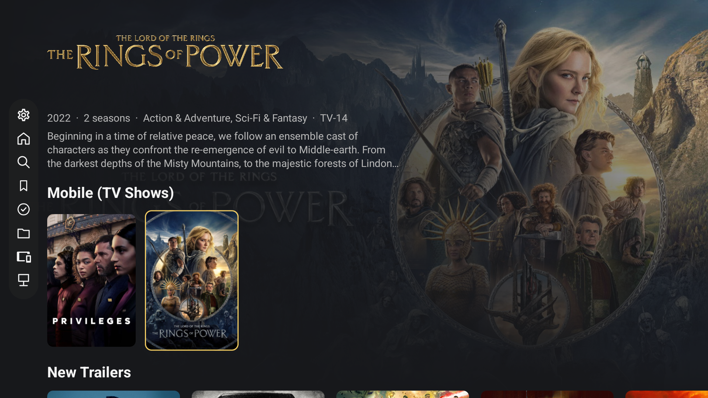
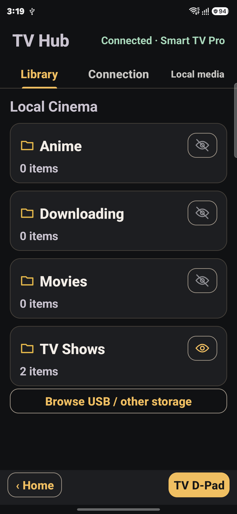
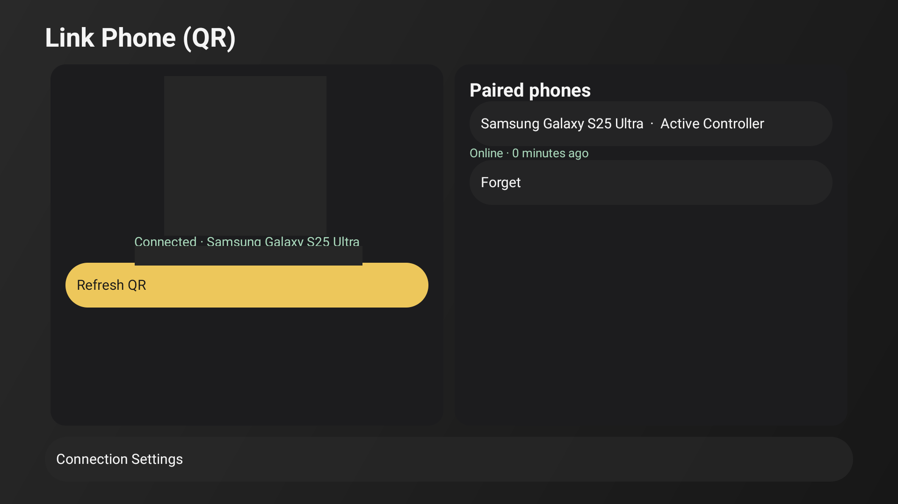
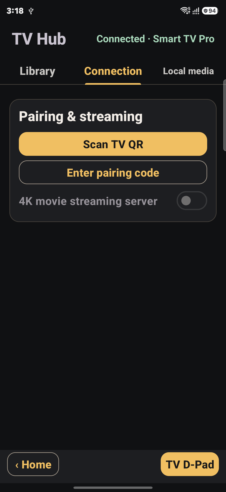
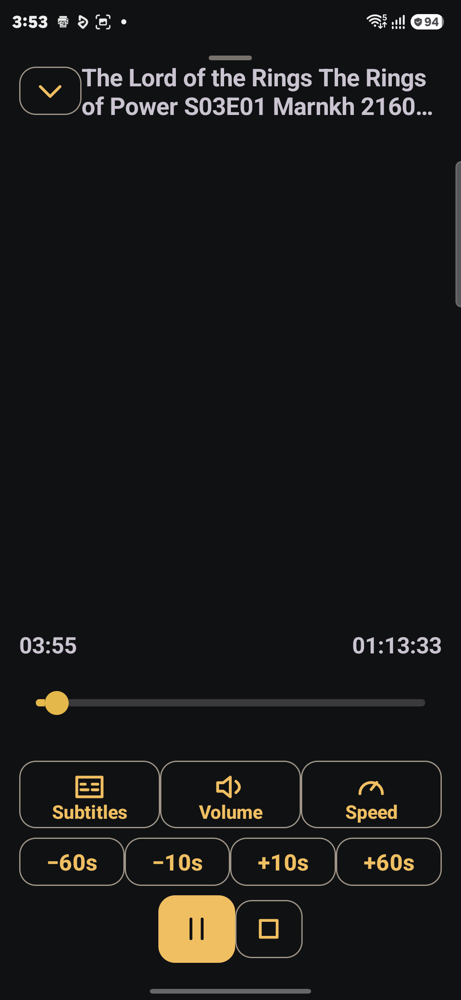

# MEEDX · Local Cinema (`v1.0.0-beta.2`)

منصة **MEEDX** وتطبيق **Local Cinema** لبث وإدارة مكتبتك المرئية والصوتية بين هاتف Android وتلفاز Android TV عبر الشبكة المحلية.

**MEEDX** & **Local Cinema** — A local-network media ecosystem pairing your Android TV player with your Android companion controller and media manager.

---

## لقطات الشاشة | Screenshots

> جميع لقطات الشاشة المعروضة هنا نسخ منظّفة من جلسات البث الفعلية (مع إخفاء رمز الاقتران وعنوان الشبكة المحلية وصور المعرض الجانبية لحماية الخصوصية).
>
> All screenshots below are privacy-redacted captures from synchronized TV and phone sessions.

| المعاينة | التلفاز (`Android TV`) | الهاتف (`Android`) |
| --- | :---: | :---: |
| **نشر مكتبة الهاتف على التلفاز**<br>Publishing the phone library to TV |  |  |
| **اقتران الهاتف بالتلفاز**<br>Pairing the phone and TV |  |  |
| **تشغيل الفيديو والتحكم من الهاتف**<br>Video playback with phone controls |  |  |
| **عرض الترجمة العربية**<br>Arabic subtitles during playback |  |  |
| **بث الصوت والموجات الذهبية**<br>Audio casting & gold visualizer |  |  |
| **عرض الصور من الهاتف**<br>Casting photos from the phone |  |  |

---

## العربية — مميزات المنظومة والإرشادات

### مميزات Local Cinema (`v1.0.0-beta.2` · `versionCode = 2`)
- **تشغيل ومكتبة متكاملة على Android TV**: دعم التخزين المحلي وUSB/SAF ومجلدات الشبكة (SMB) والمجلدات المنشورة من الهاتف عبر WebDAV.
- **تطبيق الهاتف المرافق (`TV Hub`)**: اقتران عبر QR أو الرمز اليدوي على الشبكة المحلية، تحكم هجين باللمس والأزرار (Touchpad / D-Pad)، بث مقاطع الفيديو والصوت والصور، ونشر مكتبة الهاتف أو التورنت المتسلسل مباشرة للتلفاز.
- **بوسترات وتقييمات تلقائية بلا مفاتيح (`Zero-Config`)**:
  - تعمل البوسترات والخلفيات والوصف وسنة الإصدار والتقييمات **تلقائياً دون أي مفاتيح API**:
    - **Cinemeta**: لبوسترات وملخصات الأفلام والمسلسلات وتقييم **IMDb**.
    - **TVmaze**: لمساندة مطابقة عناوين المسلسلات.
    - **Jikan**: لبوسترات الأنمي وتقييم **MyAnimeList (MAL)** عند تطابق العنوان والسنة.
    - **ويكيبيديا العربية**: لعرض الملخصات العربية تلقائياً عند توفر رابط عربي للمقال المطابق.
  - كما يمكنك اختيار **TMDb** وإدخال مفتاحك الشخصي من القسم نفسه إذا رغبت.
- **الترجمة ومصادرها (`Subsource` الافتراضي + `OpenSubtitles`)**:
  - **التلفاز يدير إعدادات المزوّدين وطلبات البيانات، والهاتف هو جهاز التحكم المرافق.** تُحفظ المفاتيح محلياً ومشفّرةً على الجهاز.
  - **`Subsource`** هو مصدر الترجمة الافتراضي، مع إمكانية التبديل إلى **`OpenSubtitles`** أو تفعيل **كليهما معاً** (بحث متوازٍ يعرض النتائج مجمّعة باسم المزوّد مع ترتيب الترجمة العربية داخل كل مجموعة).

### دليل تفعيل مفاتيح الترجمة (`Subtitles`)
1. على التلفاز افتح **`Subtitles` ← `إعدادات مصادر الترجمة`** (أو من الإعدادات).
2. سجّل الدخول في **`subsource.net`** وأنشئ مفتاح API من حسابك، أو أنشئ مفتاحاً من قسم **`API Consumers`** في ملفك على **`opensubtitles.com`**.
3. ألصق المفتاح في حقل المزوّد واضغط **حفظ** (أو أكّد المعاينة).
4. اختر **`Subsource`** (الافتراضي) أو **`OpenSubtitles`** أو **كليهما**.
5. *نصيحة*: عند اقتران الهاتف بالتلفاز على شبكة محلية موثوقة وتفعيل إدخال الريموت على التلفاز، يمكنك لصق المفاتيح مباشرة من لوحة كتابة الريموت في الهاتف.

---

## English — Ecosystem Features & Setup Guide

### Local Cinema Highlights (`v1.0.0-beta.2` · `versionCode = 2`)
- **Android TV Player & Library**: Indexes local storage, USB/SAF drives, SMB network shares, and read-only WebDAV folders published by the paired phone.
- **Phone Companion (`TV Hub`)**: Local-network pairing via QR or manual code, hybrid Touchpad/D-Pad remote control, video/audio/photo casting, browser media grabbing, and sequential torrent streaming to TV.
- **Zero-Config Metadata & Posters (No Keys Required)**:
  - Artwork, synopsis, release year, and ratings work **automatically out of the box without any API keys**:
    - **Cinemeta**: Movie & series artwork, synopsis, release year, and **IMDb** ratings.
    - **TVmaze**: Supplementary series title lookup.
    - **Jikan**: Anime artwork and **MAL** scores when title and year match.
    - **Arabic Wikipedia**: Arabic synopsis automatically loaded when the matching English article exposes an Arabic interlanguage link.
  - Personal **TMDb** remains selectable with its own key field if you prefer.
- **Subtitles (`Subsource` Default + `OpenSubtitles`)**:
  - **The TV owns provider settings and requests; the phone is the companion controller.** Keys are stored encrypted locally on-device.
  - **`Subsource`** is the default subtitle source, and you can switch to **`OpenSubtitles`** or enable **both** (concurrent query with provider-labelled result groups and Arabic ordering inside each group).

### Subtitle Sources Guide
1. On the TV, open **`Subtitles` → `Subtitle Sources Settings`** (also accessible from Settings).
2. Sign in at **`subsource.net`** and create an API key from your account, or create an **API Consumer** in your profile at **`opensubtitles.com`**.
3. Paste the key into the matching provider field and press **Save** or confirm the preview.
4. Choose **`Subsource`** (default), **`OpenSubtitles`**, or **both**.
5. *Tip*: When paired on a trusted local network with the TV remote keyboard active, you can paste keys directly from the phone's remote keyboard.

---

## ملفات الإصدار وبصمات التحقق | Release Files & SHA-256 Checksums (`v1.0.0-beta.2`)

| File | Package ID | Version (`code`) | Size (Bytes) | `SHA-256` |
| --- | --- | --- | ---: | --- |
| `LocalCinema-TV-v1.0.0-beta.2.apk` | `com.meedx.localcinema.tv` | `1.0.0-beta.2` (`2`) | `38,623,848` | `245b51c1adfd48bb2344afd7d20eadd278bf8fe9680b720468bcc9aa19b1b372` |
| `LocalCinema-Manager-Phone-v1.0.0-beta.2.apk` | `com.meedx.localcinema.manager` | `1.0.0-beta.2` (`2`) | `605,953,911` | `d0ac4190867a8d0f5cfd0eeca606b9671a1a2db39e8b6a5ee00299fbef397750` |

> قارن بصمة `SHA-256` للملف الذي قمت بتحميله مع الجدول أعلاه قبل التثبيت. تم تدقيق الحزمتين للتأكد من خلوّهما من أي مفاتيح أو أسرار تاريخية.
>
> Verify the downloaded file's `SHA-256` checksum against the table above before installing. Both binaries passed a full decompressed ZIP entry audit confirming zero embedded provider secrets.

---

## MEEDX Studio Website (Development & Build)

Arabic RTL by default, with an English LTR toggle. The gallery contains ten bilingual slides made from the supplied synchronized TV and phone captures. Open either device image to zoom from 100% to 300%, pan, or switch devices via mouse wheel, touch pinch, or keyboard controls.

```powershell
npm install
npm run verify
npm run build
npm run preview -- --host 127.0.0.1
node scripts/verify-ui.mjs
.\backup-site.bat
```

### Supplied assets & updates
- Run `python scripts/sync-assets.py` to import assets from `MEEDX_Assets` (requires Python 3.11+, Pillow for privacy redactions, and Android SDK Build Tools 36.0.0).
- `tv_2026-11-15_15-18-45.png` (pairing QR & TV network address) and `phone_2026-11-15_15-58-19.png` (unrelated private thumbnails) are redacted in `public/assets/screenshots/`.
- `src/config/siteConfig.js`, `src/data/catalog.json`, and `public/api/version.json` serve the verified GitHub Releases download links and in-app auto-update metadata (`_headers` sets `Cache-Control: no-cache` on `/api/version.json` and security headers across the site).
